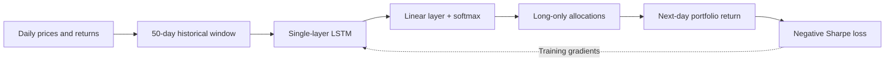
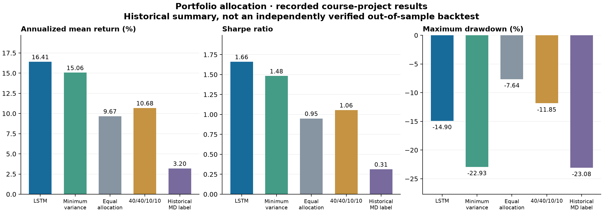
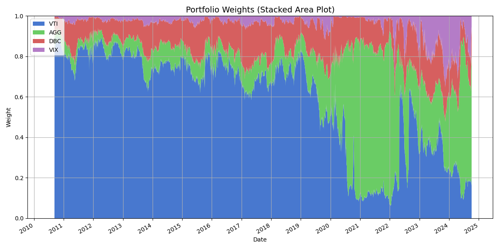
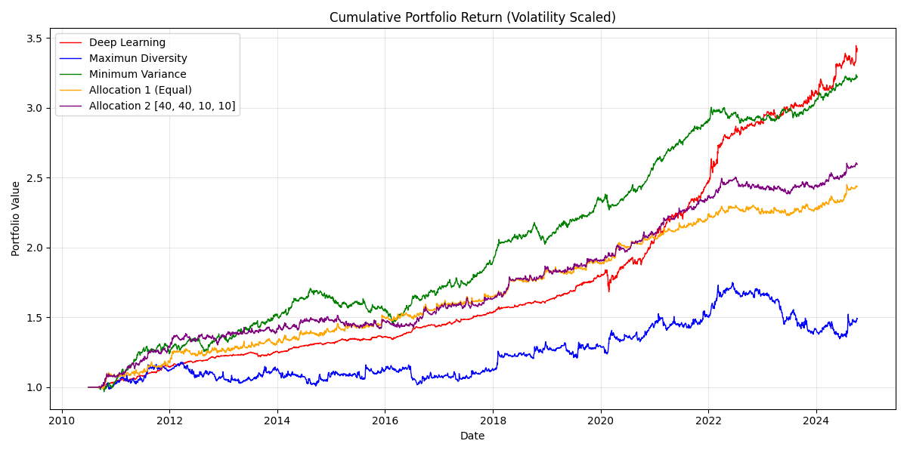
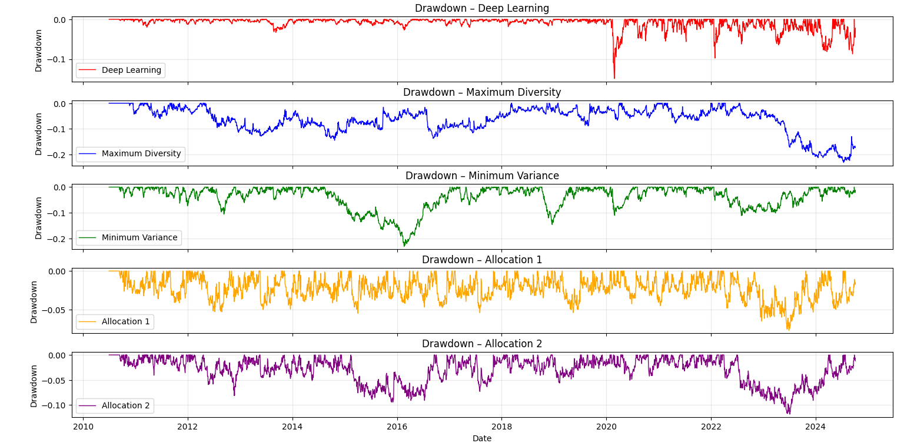

# Portfolio Optimization with LSTM

**Learn portfolio allocations directly—not return forecasts.**

[](https://github.com/AlexM3020/portfolio-lstm/actions/workflows/tests.yml)


[](https://arxiv.org/abs/2005.13665)

A course-project replication of the core methodology in **[Deep Learning for Portfolio Optimization](https://arxiv.org/abs/2005.13665)** by **Zihao Zhang, Stefan Zohren, and Stephen Roberts** (2020), **Oxford-Man Institute of Quantitative Finance, University of Oxford**.

Developed for *Introduction to Control and Machine Learning*, the project combines a PyTorch LSTM allocator, a differentiable Sharpe-ratio objective, classical portfolio baselines, and historical performance analysis. This repository brings the original code and previously separate results together, alongside a modular, tested implementation for new experiments.

> **Replication scope:** this reproduces the paper’s main modeling idea, not its exact published experiment. The asset universe, 50-day inputs, softmax allocations, and direct Sharpe objective match the paper; the period, model size, and evaluation details differ. [See the methodology comparison](docs/replication.md).

## At a glance

- **End-to-end allocation:** optimize portfolio performance through the network instead of forecasting prices first.
- **Temporal modeling:** 50 daily observations × 8 features → a single-layer LSTM → 4 allocation weights.
- **Risk–return analysis:** compare returns, Sharpe, Sortino, drawdowns, and changing allocations.
- **Reproducible engineering:** explicit CLI commands, chronological validation, shared metrics, regression tests, and migration checksums.
- **Preserved evidence:** all 14 original figures, numeric exports, data snapshots, and both sets of original scripts.

## How it works



The model maps past observations to weights $w_{i,t-1}$ and is trained on the realized portfolio return $R_{p,t}=\sum_i w_{i,t-1}r_{i,t}$. Softmax ensures $w_i\geq0$ and $\sum_i w_i=1$. The loss is the negative mini-batch Sharpe ratio, using a zero risk-free rate and a small stabilizing denominator.

### Asset universe

| Symbol | Series | Role |
|---|---|---|
| VTI | Vanguard Total Stock Market ETF | US equities |
| AGG | iShares Core US Aggregate Bond ETF | US bonds |
| DBC | Invesco DB Commodity Index Tracking Fund | Commodities |
| ^VIX / VIX | Cboe Volatility Index | Historical volatility-index proxy |

**VIX is an index, not a directly tradable ETF.** Its index-level returns are retained to reflect the original academic experiment; they are not returns of an investable volatility product. The canonical implementation orders assets as **VTI, AGG, DBC, VIX**, regardless of CSV column order.

## Historical results

The original course project reported the following summary for its **2010–2024** experiment. Values are preserved from the archived comparison script; they are **recorded historical results, not a fresh or independently verified out-of-sample backtest**.

| Strategy | Annualized mean return | Sharpe | Sortino | Maximum drawdown |
|---|---:|---:|---:|---:|
| **LSTM** | **16.41%** | **1.66** | 2.23 | −14.90% |
| Minimum variance | 15.06% | 1.48 | **2.31** | −22.93% |
| Equal allocation | 9.67% | 0.95 | 1.91 | **−7.64%** |
| 40/40/10/10 allocation | 10.68% | 1.06 | 1.93 | −11.85% |
| Historical “maximum diversity” label¹ | 3.20% | 0.31 | 0.53 | −23.08% |



**Takeaway:** the recorded LSTM result leads on annualized mean return and Sharpe, while minimum variance has the higher Sortino and fixed allocations have shallower drawdowns. This illustrates the trade-off between return, risk-adjusted performance, and downside protection.

¹ The archived strategy called MD actually optimizes a mean-return-minus-variance objective, not the classical maximum-diversification ratio. Its label is preserved as historical context; the new runner implements the genuine ratio separately.

<details>
<summary><strong>Explore the original figures</strong></summary>

**Changing allocations**



**Strategy comparison**



**Drawdowns**



Original charts are retained unchanged. Some use additive cumulative-return conventions or generated/shifted dates; use them as historical illustrations rather than audited compounded equity curves. [Full figure gallery and artifact notes](results/historical/README.md).

</details>

### What can be reproduced?

The recorded table and its new summary chart can be regenerated **without training or downloading data**. Exact reconstruction of the original LSTM performance is not currently possible: the source repository did not contain the trained checkpoints or LSTM daily-return exports. Historical scripts also contain full-period normalization and evaluation issues. These are documented in the [reproducibility notes](docs/replication.md), rather than hidden by changing the saved results.

## Quick start

Use **Python 3.10+**. Commands below are run from the repository root.

```bash
python -m venv .venv
# Activate: .venv\Scripts\Activate.ps1 (PowerShell)
# Or: source .venv/bin/activate (macOS/Linux)
python -m pip install -e ".[dev]"
```

### 1. Recreate the historical summary

```bash
portfolio-lstm report --output runs/historical-report
```

Writes a chart and machine-readable CSV from the archived metric table. No network access or model fitting occurs.

### 2. Run a small new experiment

```bash
portfolio-lstm backtest \
	--prices data/snapshots/etf_data_2010_2024.csv \
	--output runs/smoke \
	--epochs 1 --hidden-size 8 --first-test-year 2024
```

The example uses Bash line continuation; in PowerShell, put it on one line or use backticks. **One epoch is a smoke test, not a performance study.** A standard new run uses `--epochs 100 --hidden-size 128 --first-test-year 2012`; use `--hidden-size 64` to match the paper’s reported hidden size. Run time depends on the machine and settings.

The refactored runner:

1. Preserves actual trading dates and pairs each historical window with the next day’s return.
2. Fits feature normalization using training observations only.
3. Reserves the final 10% of pre-test samples for chronological validation.
4. Restores the best validation checkpoint for each two-year test fold.
5. Evaluates untouched test dates and concatenates their predictions without overlap.
6. Compares LSTM, equal allocation, 40/40/10/10, rolling minimum variance, and rolling maximum diversification over the same dates.

Each run writes dated predictions, per-fold checkpoints, training histories, input fingerprint/settings, shared metrics, and a performance chart to the chosen output directory. Existing nonempty run directories are never overwritten.

**New runs are deliberately unscaled and exclude transaction costs.** They are separate experiments—not replacements for the historical volatility-adjusted results. There is no claim of investable performance or paper-equivalent reproduction.

### 3. Optional: download fresh prices

```bash
python -m pip install -e ".[download]"
portfolio-lstm download --output data/downloads/prices.csv --start 2010-01-01 --end 2025-01-01
```

Yahoo Finance’s end date is exclusive. Updated prices/adjustments can differ from the committed snapshot. See [data provenance](data/README.md) for the retained datasets and usage considerations.

### 4. Verify and test

```bash
python -m pytest
python scripts/verify_migration.py
```

Tests cover allocation constraints/gradients, next-day alignment, training-only normalization, baseline constraints, compounding/drawdown, snapshot validation, historical-table parsing, side-effect-free imports, and a small multi-fold backtest. GitHub Actions runs the checks on Python 3.10 and 3.12; the workflow badge reflects remote execution after publication.

## Repository map

```text
src/portfolio_lstm/        Modular LSTM, data, loss, baselines, backtest, CLI, reporting
tests/                    Numerical and chronological regression tests
scripts/                  Migration integrity checker
data/snapshots/            Original price and feature snapshots
results/historical/       Recorded metrics, numeric artifacts, all 14 original figures
legacy/code-repository/   Original portfolio-lstm scripts, unchanged
legacy/results-repository/ Original results-repository scripts and README, unchanged
docs/                     Replication comparison and migration inventory
.github/workflows/        Automated tests
```

The **active implementation** is under [src/portfolio_lstm](src/portfolio_lstm/). Archived scripts are retained for provenance, not presented as the supported execution path. IDE files and the unresolved nested-repository link were excluded from the curated project; the [migration record](docs/migration.md) accounts for every source entry.

## Reference

Zhang, Z., Zohren, S., & Roberts, S. (2020). **Deep Learning for Portfolio Optimization.** *The Journal of Financial Data Science*, 2(4), 8–20. [DOI: 10.3905/jfds.2020.1.042](https://doi.org/10.3905/jfds.2020.1.042) · [Open-access preprint](https://arxiv.org/abs/2005.13665) · [BibTeX](docs/references.bib).

The citation was identified by matching the project’s distinctive methodology with the paper’s full text and confirmed by the project author. The paper is affiliated with **Oxford, not Stanford**; the original repositories contained no explicit bibliography.

**Educational research project. Not investment advice.** No new license has been assigned to the original code or market-data snapshots; consult the original authors and data provider’s terms before redistribution or reuse.
